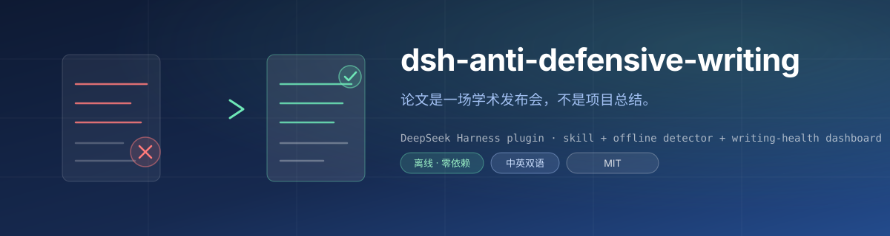
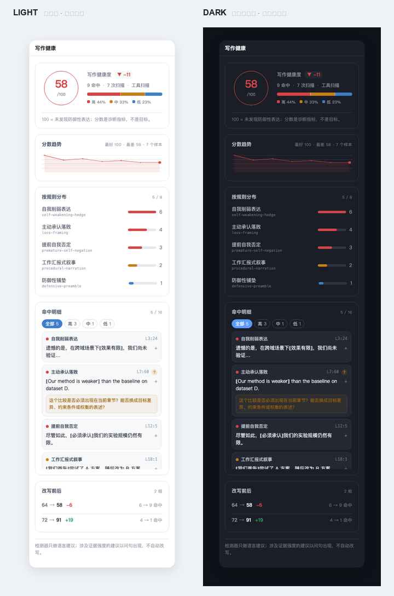

<div align="center">



**论文是一场学术发布会，不是项目总结。**

阻止论文防御性写作的 DeepSeek Harness 插件 —— 把「发布会原则」装进模型，用离线检测器量化防御性表达，用统计面板盯住写作健康度。

[](#许可证)
[](docs/notes/dsh-plugin-api.md)
[](scripts/verify.mjs)
[](https://github.com/Adkid-Zephyr/anti-defensive-writing-Skill)

</div>

---

## 它是什么

四层能力，各干各的：

| 层 | 做什么 | 在哪 |
|---|---|---|
| **L2 · Skill** | 把上游 12 条「发布会原则」装进 DSH，模型改写论文时按规则工作，触发词自动命中 | [`lib/skill-provider.js`](packages/plugin/lib/skill-provider.js) + [`skills/`](packages/plugin/skills/) |
| **L1 · 检测器** | 离线、零依赖地扫描防御性表达，给出 0–100 分与逐条命中（含行号、原文、建议） | [`packages/detector/`](packages/detector/) |
| **L3 · 自查** | `adw_scan` 工具让模型自查，`/adw` 命令让作者自查 | [`lib/tool.js`](packages/plugin/lib/tool.js)、[`lib/command.js`](packages/plugin/lib/command.js) |
| **L4 · 统计** | `adwWriting` 投影 + 侧边栏「写作健康」面板：趋势、严重度构成、按规则分布、命中明细、改写前后 | [`lib/projection.js`](packages/plugin/lib/projection.js) + [`lib/client.js`](packages/plugin/lib/client.js) |

## 为什么值得用

- **离线 · 零依赖**：检测器是纯函数深模块，`scan(text, options) → Report`，不联网、不调模型、不产生 token 费用。
- **只问不改的纪律**：涉及证据强度的建议（主动认输、局部否定、范围越界）以问句出现 —— 检测器**只提问、不代改**，不替你夸大主张，也不删必要的局限性说明。
- **反作弊设计**：分数是诊断指标不是 KPI。没有目标分数、没有排行榜、没有连续打卡 —— 删掉削弱词却加上过度主张，反而会被 `comparison-scope-creep` 抓出来。
- **中英双语**：CN/EN 词典与规则各一套，扫描和面板都支持两种语言。

## 效果对比

同一段摘要，改写前后的扫描结果：


- 左：**防御性写作 13/100**，四处命中（高 3 / 低 1）—— 检测器逐句标出问题，`?` 号表示需要你确认证据的提问。
- 右：**发布会原则 100/100**，零命中 —— **事实保留、数字未改、未新增主张**：`3.2 个点`、同一硬件、长文档不足，一个没动。

## 面板长什么样

右侧栏「写作健康」tab，改一句看一次变化（亮色 / 暗色同一套数据）：



| 区块 | 内容 | 怎么用 |
|---|---|---|
| 分数环 | 0–100 + 相比上次的 ▲▼ | 只做同文档前后对比，不跨文档比 |
| 严重度条 | 高 / 中 / 低各占几成 | 看问题的**性质**，不只看总数 |
| 分数趋势 | 最近 60 次扫描的折线 | 看曲线往下走还是稳住 |
| 按规则分布 | 你主要犯哪一类 | 决定下一步先改啥 |
| 命中明细 | 具体句子 + 行号 + 建议，可筛选、可展开 | `?` 标的是要你确认证据的 |
| 改写前后 | `72 → 91` 这类配对 | 唯一能证明「改好了」的证据 |

设置页（设置 → 反防御性写作）列出全部 8 条规则和它们的**反例** —— 告诉你哪些看着像但不会被标（例如「仅当批次大小固定时成立」不算自我削弱）：


## 快速开始

### 安装

```bash
# 方式 A：Desktop 内置 Plugins 页面搜索安装（推荐）
#   Plugins → 搜索 dsh-anti-defensive-writing → Install → 重启

# 方式 B：本地开发，把包 link 进 Desktop profile
cd ~/.dsh/profiles/desktop
pnpm add link:/path/to/anti-defensive-dsh
# 然后把包名加进 package.json 的 dsh.profile.bundles，重启

# 方式 C：发布后从 npm 安装
pnpm add dsh-anti-defensive-writing@0.1.0
```

Desktop profile 由 Electron 管理，CLI 装不进去 —— 详见 [DESIGN.md §6.4](docs/DESIGN.md#64-desktop-profile-的安装路径electron-owned)。

### 用起来（四句话上手）

```
帮我改改这段摘要，别写得那么心虚          ← 自然语言，模型自动加载 skill
写完之后，用 adw_scan 检查一下有没有防御性表达  ← 模型自查
/adw scan docs/paper.md --section abstract  ← 扫自己的文件，结果不进模型上下文
                                          ← 右侧栏「写作健康」tab 看统计
```

完整语法、分数怎么读、哪些情况**故意不命中**、排错顺序，见 **[docs/USAGE.md](docs/USAGE.md)** —— 五分钟上手。

## 测试

```bash
node scripts/verify.mjs   # 一键校验全部：62 项测试 + 同步检查 + 真实 DSH profile 组装探针
```

| 套件 | 数量 |
|---|---|
| 检测器（8 规则 · CN/EN · 章节感知 · 评分） | 25 |
| 插件 host 半（skill / 命令 / 工具 / 提示词） | 18 |
| 客户端（面板 / i18n） | 5 |
| 工具 schema（DSL ↔ JSON Schema 双路径） | 5 |
| 集成（真实命令 / 投影） | 8 |
| 真实 SkillRegistry 挂载 | 1 |

## 目录结构

```
packages/
├── detector/          # 纯函数检测器（零依赖、零 DSH 依赖）
│   ├── lib/scan.js    # scan(text, options) -> Report
│   ├── lib/rules.js   # 8 条规则 + 章节权重 + 反例
│   └── lib/lexicons.js
└── plugin/            # DSH 插件包 dsh-anti-defensive-writing
    ├── lib/index.js       # host 半：skill / command / tool / prompt / projection
    ├── lib/client.js      # client 半：侧边栏「写作健康」tab + 设置页
    ├── lib/projection.js  # adwWriting 读模型
    ├── lib/skill-provider.js
    ├── lib/tool.js        # adw_scan
    ├── lib/command.js     # /adw
    └── skills/            # 上游 SKILL.md 逐字复制（MIT）
scripts/
├── verify.mjs         # 一键校验
├── probe-profile.mjs  # 真实 DSH profile 组装探针
├── sync-detector.mjs  # detector → plugin 副本同步
└── sync-upstream.mjs  # 上游 pinned commit 校验/同步
```

## 文档

| 文档 | 一句话 |
|---|---|
| [docs/USAGE.md](docs/USAGE.md) | **怎么用**（先读这个） |
| [docs/DESIGN.md](docs/DESIGN.md) | 总体设计：产品定位、L1–L4 分层、模块与 seam、安装、里程碑 |
| [docs/notes/dsh-plugin-api.md](docs/notes/dsh-plugin-api.md) | DSH 插件 API 契约（逐条取证） |
| [docs/notes/detector-spec.md](docs/notes/detector-spec.md) | 检测器规则与评分公式 |
| [docs/notes/dashboard-design.md](docs/notes/dashboard-design.md) | 统计面板设计与数据模型 |

## 许可证

本仓库代码 MIT。上游 skill 内容（`skills/` 与 `prompts/`）逐字复制自 [Adkid-Zephyr/anti-defensive-writing-Skill](https://github.com/Adkid-Zephyr/anti-defensive-writing-Skill)（pinned commit `82d31402`，MIT），版权归 Adkid-Zephyr —— 见 [NOTICE](packages/plugin/NOTICE)、[LICENSE.upstream](packages/plugin/LICENSE.upstream) 与 [MANIFEST.json](packages/plugin/MANIFEST.json)。
