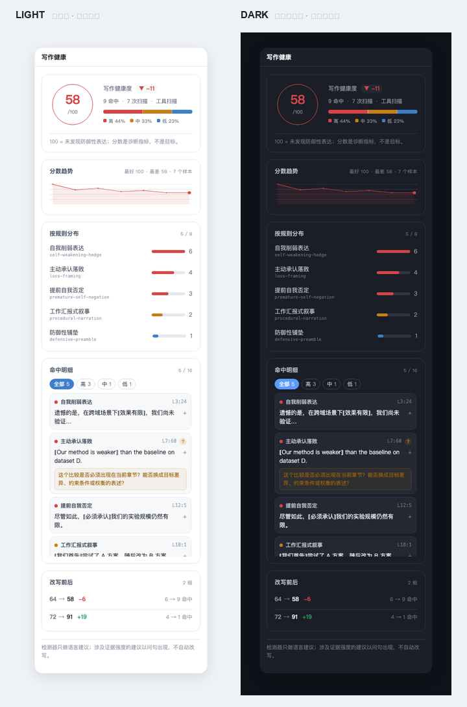

# 怎么用

> 插件已经装进你的 Desktop profile（`~/.dsh/profiles/desktop`）。
> **改完 profile 后需要完全退出并重开 DeepSeek Harness**，改动才生效。

---

## 一、四种用法，按场景选

### ① 让 AI 帮你改论文（最常用）

直接在对话里说人话就行，不需要记命令：

```
帮我改改这段摘要，别写得那么心虚
```

```
把这段引言按「发布会原则」重写：先讲问题，再讲缺口，再讲我们的做法和结果
```

```
这段 conclusion 是不是有点自我否定？帮我收紧
```

模型会自动加载 `anti-defensive-writing` skill（它的触发词包含「论文润色」「写摘要」「改引言」「rebuttal」「防御性写作」「心虚」等），并按 12 条规则来改。

**它不会做的事**：不会替你编数字、不会把「效果有限」改成「显著领先」、不会删掉必要的局限性说明。规则第 7 条明确：只有无法回避且影响核心结论时，才做必要说明。

### ② 让 AI 自查它自己写的东西

```
写完之后，用 adw_scan 检查一下有没有防御性表达
```

模型会调用 `adw_scan` 工具，拿到分数 + 逐条命中（含行号、原文、建议），然后自己修。

### ③ 扫自己的文件（不经过模型）

在输入框里输入斜杠命令：

```
/adw scan docs/paper.md
/adw scan docs/paper.md --section abstract
/adw scan docs/paper.md --min-severity high   # 只显示 high；分数仍按全部命中计算
```

输出长这样：

```
反防御性写作扫描：docs/paper.md
写作健康度 58/100 · 命中 9 处（高 4 / 中 3 / 低 2）· 防御密度 0.94/句
（另有 2 处因章节语境被忽略）

→ L3:24 [self-weakening-hedge] 「效果有限」
   删除该削弱词；若程度重要，用可核验的数字代替形容词。
? L7:60 [loss-framing] 「Our method is weaker」
   这个比较是否必须出现在当前章节？能否换成目标差异、约束条件或权衡的表述？
```

- `→` = 可以直接改（删词一类）
- `?` = **需要你确认证据**，检测器只提问、不代改

**关键**：命令结果只在 UI 显示，**不会进入模型上下文**。扫一篇 2 万字的论文不会让模型多花一分钱。

其他子命令：

```
/adw rules                     列出 8 条规则
/adw rules self-weakening-hedge 看单条规则 + 反例
/adw version                   版本
/adw on / /adw off             开关纪律提示（需重启会话）
```

### ④ 看面板

右侧栏有一个 **「写作健康」** tab：



它显示什么：

| 区块 | 内容 | 怎么用 |
|---|---|---|
| 分数环 | 0–100 + 相比上次的 ▲▼ | 只做同文档前后对比，不要跨文档比 |
| 严重度条 | 高/中/低各占几成 | 看问题的**性质**，不只看总数 |
| 分数趋势 | 最近 60 次扫描的折线 | 看曲线是往下走还是稳住 |
| 按规则分布 | 你主要犯哪一类 | 决定下一步先改啥 |
| **命中明细** | 具体句子 + 行号 + 建议 | **点句子展开完整上下文**；`?` 标的是要你确认证据的 |
| 改写前后 | 从 72 → 91 这种 | 唯一能证明「改好了」的证据 |

设置页（设置 → 反防御性写作）列出 8 条规则和它们的**反例**——告诉你哪些看着像但**不会**被标（比如「仅当…时成立」不算自我削弱）。

---

## 二、哪些情况它不会命中（故意的）

这些是合法学术表达，检测器**故意**不报：

| 你以为会被标 | 为什么不会 |
|---|---|
| 「**仅当**批次大小固定时成立」 | 条件限定，不是自贬 |
| 「This holds **only if** the data is i.i.d.」 | 同上 |
| 「**不仅**更快，而且更稳」 | 递进，不是削弱 |
| 「基线在长文档上性能下降」 | 主语是基线，是衬托你 |
| 「在表 2 列出的三个数据集上均优于基线」 | 有明确范围，是事实 |

如果误报了，说明词表需要调。见 `packages/detector/lib/lexicons.js`，改完跑 `node scripts/sync-detector.mjs`。

---

## 三、分数怎么看（重要）

```
score = clamp(100 − 40 × weightedPoints / max(句数, 4), 0, 100)
weightedPoints = Σ(严重度权重 × 章节权重)
严重度权重：high=3, medium=2, low=1
章节权重：摘要/结论 1.2，实验 0.6，局限 0.2 …
```

- **100 分不等于论文好**，只表示「这几条规则没抓到你」
- **60 分不等于论文差**，可能只是方法章节的正常限定语
- **跨文档比分数没有意义**（篇幅、章节结构不同）
- **有意义的用法**：同一段文字改之前记一个分，改之后再看

面板里刻意**没有**：目标分、达标线、等级、排行榜、连续天数。这些都会诱导你优化数字而不是优化论文。

---

## 四、遇到问题

| 现象 | 原因 | 处理 |
|---|---|---|
| 右侧栏没有「写作健康」 | 没重启 / profile 没加载 | 完全退出 app 再开 |
| `/adw` 命令不存在 | host 半没加载 | 看启动日志；确认 profile 的 bundles 里有它 |
| 面板一直是空的 | 还没有扫描样本 | 写一段话或跑 `/adw scan` |
| skill 列表里没有 anti-defensive-writing | skill provider 注册失败 | 跑 `node scripts/verify.mjs` 看 real-registry 测试 |
| 装的是 `link:`，移动了项目目录 | 符号链接断了 | 重新 `ln -sfn` 或改用打包安装 |

---

## 五、开发者入口

```bash
node scripts/verify.mjs        # 全部 79 项检查
```

| 想改什么 | 改哪里 | 改完跑 |
|---|---|---|
| 规则/词表 | `packages/detector/lib/{rules,lexicons}.js` | `node scripts/sync-detector.mjs` |
| 面板 UI | `packages/plugin/lib/client.js` | `node --test packages/plugin/test/client.test.js` |
| 统计口径 | `packages/plugin/lib/projection.js` | bump `STATE_VERSION` + 同步测试 |
| 上游 skill 内容 | 不要手改；用 `scripts/sync-upstream.mjs` | `--check` 校验哈希 |
